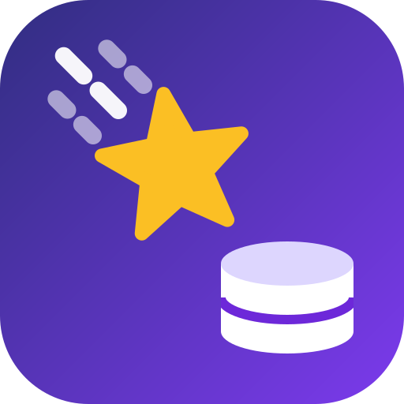

# StarPush
Project to create synchronization between salesforce records and a postgres database.

Goal
The goal of this project is to integrate with the new Salesforce Pub/Sub API to create a sync between Salesforce
and a postgres database. 

Information on the Salesforce Pub/Sub API can be found here:
https://developer.salesforce.com/docs/platform/pub-sub-api/overview

What makes this project interesting is that it uses grpc to recieve events from the Salesforce Change Data Capture event bus.
Inside the grpc payload is an Apache Avro serialized message of the Change Data Capture event. The event body only contains 
some object metadata and only the fields with data that had changed, making the event payload size very small.

Formerly SalesforceGRPC. The example App Database name `salesforce_grpc` (in `StarPush/appsettingstemplate.json` and
`docs/setup.md`) is kept as-is: an existing database keeps its name, and renaming a Postgres database is an
operational step, not a code change.
